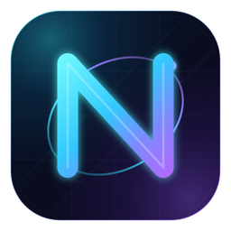
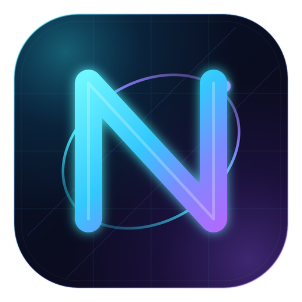

<p align="center">
  
</p>

<h1 align="center">NØVA Flash Studio</h1>

<p align="center">
  <b>A native creative studio for vector animation, character rigging,
  code and interactive 2D worlds — written in Rust.</b>
</p>

<p align="center">
  <b>Draw vectors. Build timelines. Rig characters. Write code.
  Export SWF.</b>
</p>

<p align="center">
  <a href="https://www.rust-lang.org/"></a>
  <a href="Cargo.toml"></a>
  <a href="docs/ROADMAP.md"></a>
  <a href="Cargo.toml"></a>
  
  
</p>

<p align="center">
  <a href="#-what-you-can-create">What you can create</a> ·
  <a href="#-three-editions--one-studio">Editions</a> ·
  <a href="#-file-formats">Formats</a> ·
  <a href="#-the-ai-agent">AI agent</a> ·
  <a href="#-get-nova">Get NØVA</a> ·
  <a href="#-build-it-yourself">Build from source</a> ·
  <a href="#-documentation">Documentation</a>
</p>

---

NØVA Flash Studio is an independent, native desktop authoring environment
inspired by the creative workflows of the classic Flash era. It brings
vector artwork, timeline animation, character rigging, code and
interactive 2D content together in one Rust application — with its own
project format, its own SWF writer and its own documented AS3 subset.

> **It is not Adobe Animate, not an official Flash replacement and not
> affiliated with Adobe.** Flash and Adobe are trademarks of Adobe Inc.

One studio. Several ways to create. NØVA is built for people who want to
make more than static graphics: start with a shape, turn it into an
animated character, add code and interactions, then ship an interactive
project.

The workspace combines a **stage**, a **multi-track timeline**, **vector
tools**, a **symbol library** and a **code editor** — switchable between a
focused Stage layout, a combined Stage + Code workspace, or a pure Code
view. The UI speaks five languages: `de-DE`, `en-GB`, `da-DK`, `fr-FR`,
`pl-PL`.

---

## 🎬 What you can create

<table>
<tr><td width="33%" valign="top">

### ✏️ Draw

- Pen, pencil and shape tools with interactive node editing
- Cubic Bézier segments with smooth/independent handles
- Linear & radial multi-stop gradients
- Boolean path ops — union, intersect, subtract, XOR with holes
- Bitmap and audio assets, timeline sound cues

</td><td width="33%" valign="top">

### 🎞️ Animate

- Scenes, layers, folders and masks
- Keyframes, held frames, labels, playhead scrubbing
- Motion tweens with shared easing model
- Nested MovieClips with per-symbol timelines
- Bones, FK, two-bone IK, pole targets, FABRIK chains
- Mesh skinning with weight painting

</td><td width="33%" valign="top">

### 💻 Build

- Documented ActionScript 3 subset → real AVM2 bytecode
- `game.NovaGame` kit: scenes, events, collision, camera, particles
- Tilemaps, tilesets, physics, input, game templates
- Binary SWF export (FWS/CWS), Ruffle-verified fixtures
- Stage / Stage+Code / Code workspace layouts

</td></tr>
</table>

### Feature status — honestly

| Area | Status | Notes |
|---|---|---|
| Scenes, layers, timeline, keyframes, tweens | ✅ Implemented | Core authoring workflow |
| Vector tools, Béziers, gradients, Booleans | ✅ Implemented | Native vector editing |
| Bones, FK, IK, mesh skinning | ✅ Implemented | Weight painting included |
| Nested symbols & MovieClip timelines | ✅ Implemented | Symbol library + nested editing |
| ActionScript 3 | 🟡 Subset | Unsupported constructs are diagnosed, never silently accepted |
| SWF generation | ✅ Implemented | FWS/CWS; compatibility depends on features used |
| Ruffle validation | ✅ Verified fixtures | Documented demos/templates tested with Ruffle 0.7.1 |
| Adobe Flash Player playback | ⚪ Not verified | External projector launch supported; playback not certified |
| Particle emitters | 🟡 Preview only | Simulated in editor; not exported to SWF/XFL |
| Morph shapes / animation constraints | ⚪ Not implemented | Documented open roadmap items |

> **A note on compatibility:** an editor feature does not automatically
> imply support in every export target. NØVA reports unsupported or
> partially supported data during import/export — see
> [docs/FORMAT_COMPATIBILITY.md](docs/FORMAT_COMPATIBILITY.md).

---

## 🏢 Three editions — one studio

All editions are built from the **same Rust repository** and share the
same core authoring capabilities. Each edition adds a different
workflow — and none of them restricts the others.

| | **NØVA User** | **NØVA Edu** | **NØVA Enterprise** |
|---|---|---|---|
| **For** | Individual creators & indie devs | Teachers, students, schools | Teams and studios |
| **Setup EXE** | `NOVA-User-Setup.exe` | `NOVA-Edu-Setup.exe` | `NOVA-Enterprise-Setup.exe` |
| **Portable ZIP** | `NOVA-User-Portable.zip` | `NOVA-Edu-Portable.zip` | `NOVA-Enterprise-Portable.zip` |
| **Config dir** | `NOVA Flash Studio` | `NOVA Flash Studio Edu` | `NOVA Flash Studio Enterprise` |
| **Core editor** | ✅ | ✅ | ✅ |
| **Extra workspace** | — | 🏫 Classroom: assignments, submissions, feedback, progress | 🏛️ Workspaces, asset library, snapshots, reviews, audit log, `.novaent` packages |

The editions have separate branding, installer identities and
configuration directories. Native `.nova` projects remain
**edition-neutral** (format v4) — the same project opens in every
edition.

> **Important:** Edu and Enterprise roles describe *workflow
> permissions* — they are **not** authentication systems or OS security
> boundaries. OS file permissions remain the actual access boundary.

More: [Editions](docs/EDITIONS.md) ·
[Classroom](docs/CLASSROOM.md) ·
[Enterprise](docs/ENTERPRISE.md)

---

## 📦 File formats

| Format | What NØVA supports | What to know |
|---|---|---|
| **`.nova`** | Native project import & export (v4, JSON) | The full-fidelity format; not an Adobe exchange format |
| **`.fla` / XFL** | CS5+ ZIP/XFL subset + uncompressed XFL folders | Binary OLE2 `.fla` is detected and rejected with guidance. **Native `.fla` writing is not implemented.** XFL ZIP export is experimental and unverified in Adobe Animate |
| **`.swf`** | SWF import + binary SWF export | Import reconstruction can be lossy: sprites may be flattened, ABC stays bytecode (not original source) |

Every import/export can produce a **compatibility report** describing
unsupported content — nothing is silently dropped. See
[docs/FORMAT_COMPATIBILITY.md](docs/FORMAT_COMPATIBILITY.md) before
relying on round-trip conversion.

---

## 🤖 The AI Agent

The **AI Agent Editor** (`Ctrl+Shift+A`) inspects a project and proposes
changes through a controlled workflow — designed around permissions
and review, not unrestricted computer access.

**Providers:** Ollama (local & Ollama Cloud), Groq, OpenAI-compatible
endpoints. Credentials live in the OS credential store — never in
project files or logs. Cloud use requires explicit per-session consent.

**How an agent task works:**

1. Grant access — selected files/folders, project tree, or read-only.
2. Plan — the agent presents its proposed approach for approval.
3. Stage — file and editor changes land in an isolated review session.
4. Review — per-file diffs; approve only what you want applied.
5. Verify — builds/tests run in a task-specific project copy with
   allowlisted commands.

The tool registry exposes **validated project and editor operations** —
providers with native tool calling use it, others use a validated
structured-text fallback. Model output is **never executed as code**.

> **Sandbox boundary:** the build/test sandbox is a *copy* of the
> project with command allowlisting. It is **not** OS-level process,
> network or filesystem isolation — do not treat it as a hardened
> boundary for hostile projects.

Read: [AI Agent Editor](docs/AI_AGENT_EDITOR.md) ·
[Provider guide](docs/AI_PROVIDER_GUIDE.md) ·
[Security](docs/SECURITY.md)

---

## ⬇️ Get NØVA

### Windows

Each edition is built in two forms:

| Package | Description |
|---|---|
| **Portable ZIP** | Extract and run — fully portable, no installer |
| **Setup EXE** | Self-contained installer (.NET 8): per-user install by default (no admin), optional all-users, custom directory, `.nova`/`.swf` associations, upgrade handling, uninstaller |

> **Signing status:** current packages are **unsigned**
> (`SIGNING_NOT_CONFIGURED`). Windows SmartScreen or Defender may show
> warnings — expected for an unsigned release candidate. The Authenticode
> pipeline (SHA-256 + RFC-3161 timestamp) is implemented and ready for a
> real certificate — see [docs/CODE_SIGNING.md](docs/CODE_SIGNING.md).

There is **no public download yet** — packages are produced locally or
through the repository's packaging workflow under
`dist/windows/<edition>/` and `release/<version>/windows/`.

### macOS & Linux

Packaging scripts exist (`scripts/package-macos.sh`,
`scripts/package-linux.sh`) but have **not been built or tested on their
native hosts** — prepared, not verified.

---

## 🛠️ Build it yourself

### Requirements

- **Rust 1.88+** (Rust 2024 edition)
- **Windows:** MSVC build tools; .NET 8 SDK (installer only);
  Windows SDK optional (version resources, code signing)
- A desktop session with GPU support for the GUI

### Clone and run

```powershell
git clone https://github.com/baummarder/nova-flash-studio.git
cd nova-flash-studio

# Launch the desktop application (built-in demo project)
cargo run -p nova-app

# Complete workspace test suite
cargo test --workspace

# Formatting + lint gates
cargo fmt --all -- --check
cargo clippy --workspace --all-targets -- -D warnings

# Headless CLI companion
cargo run -p nova-cli -- --help
cargo run -p nova-cli -- demo samples/nova-demo.swf
cargo run -p nova-cli -- export samples/as3-example.nova samples/as3-example.swf
```

### Build an edition

Packaged binaries select their edition at compile time:

```powershell
$env:NOVA_EDITION = 'user'        # or 'edu' / 'enterprise'
cargo build --release -p nova-app
```

For full packaging/release workflows start with
[docs/PACKAGING.md](docs/PACKAGING.md) and
[docs/RELEASE.md](docs/RELEASE.md).

---

## 🧱 Under the hood

```text
crates/
├── nova-core/      Project model, timeline, animation, game runtime, edition identity
├── nova-formats/   .nova persistence, FLA/XFL and SWF import/export
├── nova-swf/       Spec-based SWF bit writer + independent tag reader
├── nova-build/     Project → SWF baking, DoABC2/SymbolClass script linking
├── nova-as/        AS3 lexer, parser, type checker, AVM2 ABC emitter
├── nova-script/    QuickJS host for editor tools (not AS3)
├── nova-ai/        Providers, credentials, grants, review, sandbox, tool registry
├── nova-edu/       Classroom workflows, assignments, submissions, feedback
├── nova-ent/       Enterprise workspaces, assets, snapshots, reviews, audit
├── nova-app/       eframe desktop UI, branding, i18n, AI workspace
└── nova-cli/       Headless import/export/analyze/build/probe companion

packaging/          editions.json (identity source of truth), installer project
scripts/            Packaging, installer tests, signing, release automation
legal/              License texts, third-party notices, EULA drafts
docs/               Architecture, compatibility, security, milestone reports
samples/            Demo projects + Ruffle verification captures
```

Details: [docs/ARCHITECTURE.md](docs/ARCHITECTURE.md)

---

## 📸 Screenshots

> **TODO:** Application screenshots are not yet committed. Planned
> captures: main authoring layout (Stage + Code split), timeline with
> tweens, vector/gradient editing, skeletal weight painting, tilemap
> editor, AI Agent review diff, installer wizard in all five languages.
> Genuine captures only — no mockups.

<p align="center">
  
</p>
<p align="center"><i>Make something move.</i></p>

---

## 🚦 Project status

**Current version: `0.20.0-rc1`** — release candidate, active
development, not yet stable 1.0.

- ✅ Core authoring, animation, vector tools, editions, installer and
  AI workflow — implemented and regression-tested
- ✅ Windows — the only platform built and tested on its native host
- 🟡 SWF compatibility is feature-dependent; Ruffle verification covers
  documented fixtures
- ⚪ Adobe Flash Player playback — not verified
- ⚪ No public signed release yet; EULA texts are drafts pending legal
  review with unresolved rights-holder placeholders

Follow the [roadmap](docs/ROADMAP.md) and the milestone reports under
`docs/` for the full delivery history (M9 → M29).

---

## 🤝 Contributing

Bug reports, documentation improvements and code contributions are
welcome.

- Check the [roadmap](docs/ROADMAP.md) and existing issues first
- Bugs: reproduction steps + expected/actual behavior (+ compatibility
  report for format issues)
- `cargo test --workspace` must stay green; `fmt` + `clippy -D warnings`
  are enforced
- Update docs when behavior or compatibility changes — this project
  documents limitations explicitly rather than implying them away
- Follow [AGENTS.md](AGENTS.md), including AI co-author attribution
- Security-sensitive findings: private maintainer contact, not public
  issues

---

## 🔒 Security & privacy

- **Offline-first** — no mandatory account, cloud, telemetry, DRM or
  activation check
- Local Ollama inference can remain entirely on-device
- Cloud providers only after configuration + explicit session consent
- AI file access restricted by project grants + sensitive-path denylist
- AI build/test sandbox = project copy, **not** OS-level isolation
- Installer scopes registry/association changes to its own entries and
  preserves user project data on uninstall

See [docs/SECURITY.md](docs/SECURITY.md) for the real boundaries.

---

## 📜 License & legal

**MIT OR Apache-2.0** at your option — see `Cargo.toml`, full texts in
`legal/` and shipped in every package.

- Third-party notices: [`legal/THIRD-PARTY-NOTICES.md`](legal/THIRD-PARTY-NOTICES.md)
  + SPDX texts in `LICENSES/`
- EULA drafts: `legal/LICENSE-EULA*` — five languages, translated from
  a draft pending legal review; `[RECHTEINHABER]`/contact placeholders
  intentionally unresolved → [docs/EULA.md](docs/EULA.md),
  [docs/LICENSING.md](docs/LICENSING.md)
- Flash/Adobe trademarks belong to Adobe Inc.; NØVA is independent and
  unaffiliated

---

## 📚 Documentation

| Guide | Content |
|---|---|
| [Architecture](docs/ARCHITECTURE.md) | Crate boundaries, data flow, formats, UI design |
| [Editions](docs/EDITIONS.md) | User / Edu / Enterprise differences |
| [Format compatibility](docs/FORMAT_COMPATIBILITY.md) | `.nova`, FLA/XFL, SWF subsets & honest limits |
| [AS3 compiler](docs/AS3_COMPILER.md) | Supported ActionScript subset & diagnostics |
| [AI Agent Editor](docs/AI_AGENT_EDITOR.md) | Agent workflow, tools, permissions, sandbox |
| [AI provider guide](docs/AI_PROVIDER_GUIDE.md) | Provider setup & credentials |
| [Packaging](docs/PACKAGING.md) | Platform packaging & signing |
| [Release process](docs/RELEASE.md) | Release assembly & verification |
| [Code signing](docs/CODE_SIGNING.md) | Authenticode setup & certificate requirements |
| [Security](docs/SECURITY.md) | Security boundaries & limitations |
| [Roadmap](docs/ROADMAP.md) | Milestones & planned work |
| [Testing](docs/TESTING.md) | Test strategy & verification |
| [Flash comparison](docs/FLASH_COMPARISON.md) | Scope vs. classic Flash authoring |
| `docs/MEGA_MILESTONE_*` | Per-milestone delivery reports (M9–M29) |

---

<p align="center">
  <b>NØVA Flash Studio</b> — <i>make something move.</i><br>
  <sub>MIT OR Apache-2.0 · offline-first · no accounts, no telemetry</sub>
</p>
